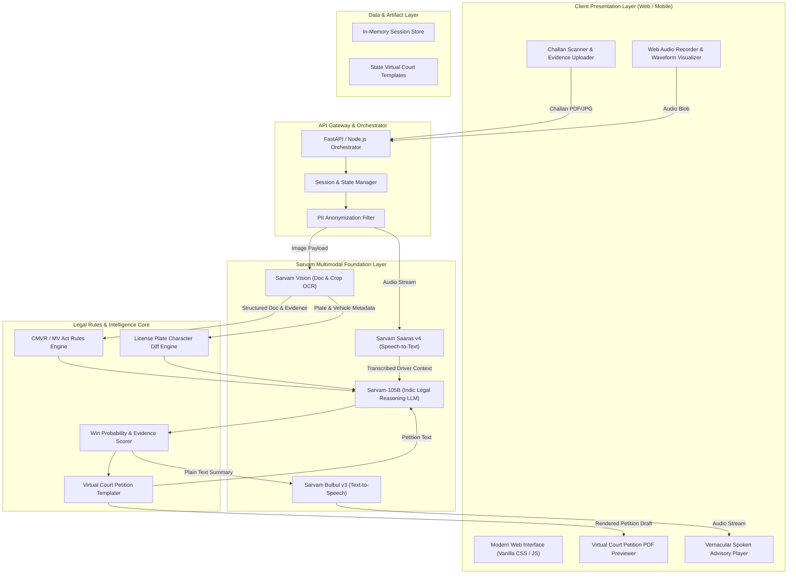
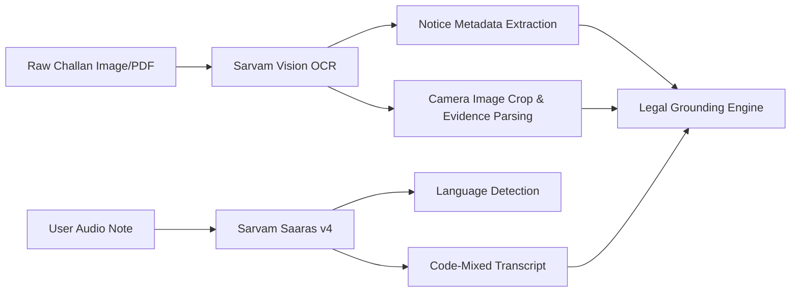
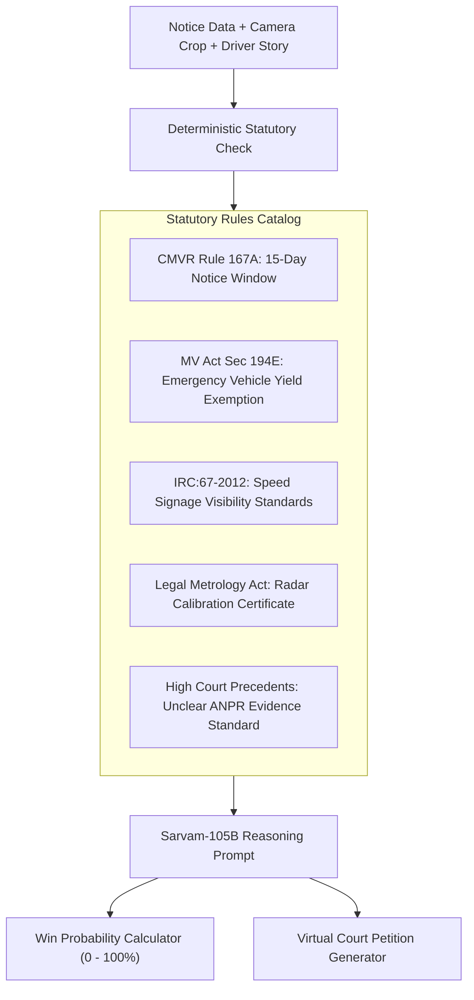
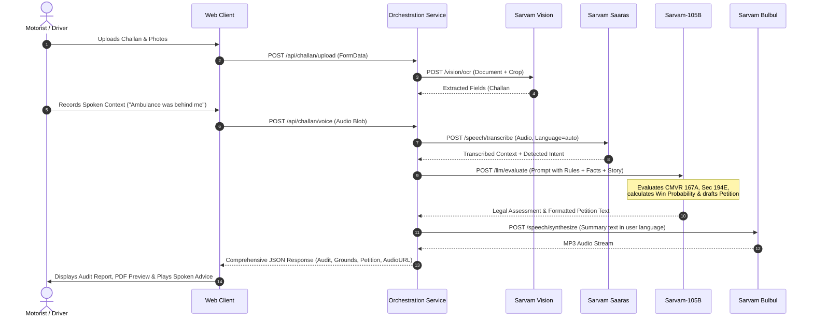

# ChallanAI (ChallanNyay) — System Architecture & Technical Design

> **Document Version:** 1.0.0  
> **Target Audience:** Hackathon Judges, Technical Evaluators, and Engineering Team  
> **Status:** Architecture Baseline

---

## 1. System Overview

**ChallanAI** is a multimodal AI-powered legal copilot designed to automate the defense and contestation of traffic e-challans in India. The platform integrates **Sarvam Vision** for document and photographic evidence extraction, **Sarvam Saaras v4** for multilingual voice ingestion, **Sarvam-105B** for legal statutory reasoning, and **Sarvam Bulbul v3** for conversational vernacular advisories.



---

## 2. Layered Architecture Breakdown

### 2.1 Presentation Layer (Frontend)
Built using responsive **Vanilla HTML5, CSS3, and modern JavaScript (ESNext)** to guarantee zero-dependency execution, maximum UI control, and lightning-fast load times:
* **Evidence Bounding-Box Overlay:** Uses an HTML5 `<canvas>` layer positioned over the uploaded Challan camera photo to highlight the license plate crop, speed watermark, and timestamp.
* **Audio Capture & Visualizer:** Utilizes the browser `MediaRecorder` API and `AudioContext` analyzer node to generate dynamic real-time frequency waveforms while the citizen narrates their context.
* **Dual-Pane Audit Workspace:**
  * *Left Pane:* Original Challan slip & camera evidence with zoom/pan inspection.
  * *Right Pane:* AI Defense Audit, Statutory Violations list, Win Probability gauge, and live editable Virtual Court petition preview.
* **Preloaded Demo Presets:** Includes 3 preconfigured real-world scenarios (Delhi, Bengaluru, Mumbai) for instantaneous demonstration without requiring external uploads.

---

### 2.2 Multimodal Ingestion Pipeline



#### A. Document & Evidence Ingestion (`Sarvam Vision`)
* **Challan Metadata Extraction:**
  * Challan Number, Issuing Authority (e.g., *Delhi Traffic Police*, *Maharashtra eChallan*).
  * Date & Time of Offence vs. Date of Issue/Dispatch.
  * Alleged Offence Section (e.g., Sec 112 for speeding, Sec 119 for red light, Sec 129 for helmet, Sec 194D for seatbelt).
  * Location Coordinates & Street Name.
* **ANPR Evidence Verification:**
  * Plate number recorded on Challan vs. Visual characters detected on the vehicle plate in the camera crop.
  * Identification of high-frequency OCR misreads: `8` ↔ `B`, `0` ↔ `D`, `1` ↔ `I`, `5` ↔ `S`.
  * Vehicle body classification check (e.g., if ticket claims *Sedan* but camera shows a *Two-Wheeler*).

#### B. Spoken Context Ingestion (`Sarvam Saaras v4`)
* Ingests voice narrations recorded via mobile browser or WhatsApp audio.
* Supports **Indic languages** (Hindi, Marathi, Tamil, Telugu, Kannada, Bengali, Gujarati, Punjabi) and **code-mixed Hinglish**.
* Automatically detects critical dispute categories:
  * Yielding to Emergency Vehicles (Ambulance / Fire).
  * Manual Traffic Police Hand Signals overriding automated signals.
  * Mechanical breakdown or flat tire forcing stopped vehicle over line.
  * Vehicle stolen / cloned plate / driver not present in city on date of incident.

---

### 2.3 Legal Reasoning & Statutory Rules Engine (`Sarvam-105B`)

The engine applies a hybrid approach combining deterministic Indian statutory rules with **Sarvam-105B** generative legal synthesis.



#### Core Statutory Defense Rules

| Defense Code | Ground / Legal Reference | Invalidation Condition |
| :--- | :--- | :--- |
| **DEF-167A** | *Central Motor Vehicles Rules (CMVR), Rule 167A(3)* | Notice issued > 15 days from the recorded date of offence. |
| **DEF-194E** | *Motor Vehicles Act 1988, Section 194E (Amended 2019)* | Vehicle moved across stop line to yield passage to emergency vehicle. |
| **DEF-ANPR** | *Evidentiary Standard under Indian Evidence Act Sec 65B* | OCR plate discrepancy, blurry image, or vehicle category mismatch. |
| **DEF-MANUAL** | *Rule of the Road Regulations, 1989, Regulation 5* | Traffic officer manual direction supersedes automated traffic lights. |
| **DEF-CALIB** | *Standards of Weights & Measures / Legal Metrology Act* | Speed gun / interceptor lacks valid annual calibration certificate. |

---

### 2.4 Petition & Vernacular Delivery Engine

#### A. Virtual Court Petition Generator
Outputs a legally compliant, formatted representation ready for submission on the official **Virtual Court Portal** (`ecourts.gov.in/virtual-court`) or submission before a **National Lok Adalat**:
* Identifies State Jurisdiction (e.g., *Metropolitan Magistrate, Virtual Court Delhi*).
* Quotes exact Sections, dates, timestamps, and camera image references.
* Details the prayer for dismissal with legal case-law citations.

#### B. Vernacular Spoken Advisory (`Sarvam Bulbul v3`)
* Translates legal findings into plain, reassuring spoken guidance.
* Outlines:
  1. **Dispute Viability:** Win Probability percentage and core reason.
  2. **Recommended Action:** Whether to pay, contest in Virtual Court, or take it to Lok Adalat.
  3. **Step-by-Step Instructions:** Exactly where to paste or upload the petition on the government portal.

---

## 3. End-to-End Data Flow & Sequence



---

## 4. API Architecture & Data Contracts

### 4.1 Ingestion Endpoints

#### `POST /api/v1/challan/analyze`
Submits the Challan image and driver voice note for complete multimodal analysis.

**Request Payload (`multipart/form-data`):**
```http
POST /api/v1/challan/analyze HTTP/1.1
Content-Type: multipart/form-data

challan_image: [binary file: challan_scan.jpg]
audio_narration: [binary file: driver_explanation.webm]
user_language: "hi" // "en" | "hi" | "mr" | "ta" | "te"
```

**Response Payload (`application/json`):**
```json
{
  "status": "success",
  "challan_id": "DL-2024-8839210",
  "extracted_data": {
    "offence_date": "2024-08-10T14:22:00+05:30",
    "notice_date": "2024-09-28T11:00:00+05:30",
    "days_elapsed": 49,
    "alleged_offence": "Exceeding Prescribed Speed Limit (Sec 112)",
    "fine_amount": 2000,
    "registered_plate": "DL 3C CS 8812",
    "camera_crop_plate": "DL 3C CS BB12",
    "location": "Barapullah Elevated Corridor, New Delhi"
  },
  "driver_context": {
    "transcript": "Gadi us din ghar pe khadi thi aur photo me car ka model alag hai.",
    "detected_language": "hi",
    "sentiment": "disputing_identity"
  },
  "legal_evaluation": {
    "win_probability": 94,
    "primary_ground": "Procedural Invalidation under CMVR Rule 167A & Vehicle Identity Mismatch",
    "statutory_violations": [
      {
        "code": "DEF-167A",
        "rule": "CMVR Rule 167A(3)",
        "verdict": "VIOLATED",
        "description": "Notice served 49 days after offence (Statutory maximum limit is 15 days)."
      },
      {
        "code": "DEF-ANPR",
        "rule": "Evidence Act Section 65B",
        "verdict": "MISIDENTIFIED",
        "description": "Plate characters '88' confused with 'BB' by automated camera OCR."
      }
    ],
    "action_recommendation": "Contest immediately in Virtual Court. Do not pay penalty."
  },
  "petition": {
    "court_name": "Virtual Court (Traffic), NCT of Delhi",
    "petitioner_name": "[Vehicle Owner]",
    "challan_number": "DL-2024-8839210",
    "formal_draft": "BEFORE THE HON'BLE METROPOLITAN MAGISTRATE, VIRTUAL TRAFFIC COURT...\n\n1. That the applicant is the registered owner...",
    "download_url": "/api/v1/petition/download/DL-2024-8839210"
  },
  "audio_advisory": {
    "audio_url": "/api/v1/audio/advisory/DL-2024-8839210.mp3",
    "duration_seconds": 38,
    "transcript": "नमस्ते। आपके चालान में दो बड़ी कानूनी खामियां हैं..."
  }
}
```

---

## 5. Security, Privacy & Compliance

1. **Ephemeral PII Handling:**  
   Challans contain sensitive owner information (Chassis Number, Engine Number, Permanent Address). All image inputs pass through an automated privacy sanitizer that masks chassis and engine numbers prior to external model routing.
2. **Non-Custodial Legal Defense:**  
   The application generates draft petitions for the user's voluntary submission, accompanied by a clear legal disclaimer pursuant to the Advocates Act, 1961:
   > *"ChallanAI generates automated representations based on statutory rules and does not constitute formal legal representation."*
3. **Local Session Sandbox:**  
   No user documents or voice recordings are retained beyond the active browser analysis session unless explicitly exported by the user.

---

## 6. Directory Structure & Implementation Layout

```
sarvam hackathon/
├── ARCHITECTURE.md                  # This technical blueprint
├── PROJECT_BLUEPRINT.md             # Project proposal & problem statement
├── Idea Library.pdf                 # Hackathon provided reference
│
├── frontend/                        # Web Client Application
│   ├── index.html                   # Core application markup
│   ├── index.css                    # Rich design system, dark mode & glassmorphism
│   ├── app.js                       # UI controller, audio visualizer & API glue
│   ├── assets/
│   │   ├── samples/                 # Preloaded realistic challan samples
│   │   │   ├── delhi_speeding.jpg   # Rule 167A delayed notice demo
│   │   │   ├── blr_redlight.jpg     # ANPR 8 vs B character mismatch demo
│   │   │   └── mum_ambulance.jpg    # Sec 194E emergency vehicle exemption demo
│   │   └── audio/                   # Sample synthetic audio responses
│
├── backend/                         # Orchestration & Integration Service
│   ├── main.py                      # FastAPI server & route handlers
│   ├── config.py                    # Environment & Sarvam API credentials
│   ├── services/
│   │   ├── vision_service.py        # Sarvam Vision OCR & crop analyzer
│   │   ├── speech_service.py        # Sarvam Saaras & Bulbul audio pipelines
│   │   ├── legal_engine.py          # Statutory rules evaluator & Sarvam-105B RAG
│   │   └── petition_builder.py      # Court petition template generator
│   └── tests/
│       └── test_rules.py            # Unit tests for CMVR 167A & Sec 194E checks
│
└── requirements.txt                 # Backend dependencies (fastapi, uvicorn, requests)
```

---

## 7. Hackathon Execution & Demo Strategy

To deliver a **compelling live demonstration to the jury**:
1. **Zero-Setup Live Showcase:** The web application includes a 1-click **"Load Demo Case"** bar at the top with three distinct, real-world traffic scenarios.
2. **Visual Evidence Highlight:** When a sample is loaded, visual bounding boxes instantaneously outline the error (e.g., highlighting that notice was issued 49 days after offence, or showing the camera zoom on the license plate).
3. **Live Voice Interaction:** Judges can click the microphone, speak an excuse in Hindi, English, or their mother tongue, and watch the system transcribe and adjust the legal defense dynamically.
4. **Export Ready:** One click generates and downloads the formatted PDF petition ready for upload to the Parivahan Virtual Court portal.
