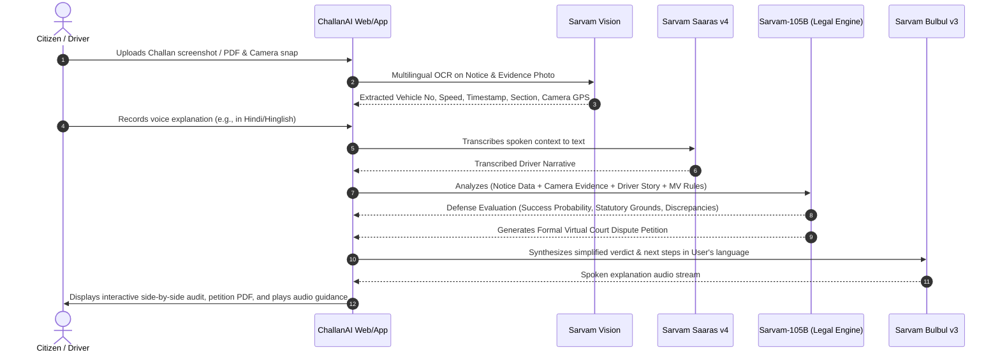

# ChallanAI (ChallanNyay | चालान-न्याय)
### Autonomous Multimodal Traffic E-Challan & Notice Defense Copilot

---

## 1. Executive Summary & Problem Statement

### The Problem
Since the nationwide rollout of the **Automated Number Plate Recognition (ANPR)** and **Intelligent Traffic Management System (ITMS)** under the Parivahan / e-Challan portal, Indian state police departments issue tens of millions of automated challans annually. 

However, over **20% to 35% of automated challans suffer from systemic flaws**:
1. **ANPR Character Misidentification:** OCR errors in speed and red-light cameras misreading license plates (e.g., `8` read as `B`, `0` read as `D`, or counterfeit/cloned number plates on different vehicle makes).
2. **Statutory Notice Delays:** Under **Rule 167A of the Central Motor Vehicles Rules (CMVR)**, notice of violation must be sent within **15 days**. Millions of challans are sent months later, rendering them procedurally void.
3. **Emergency Circumstances Unrecognized:** Camera algorithms blindly fine motorists who cross stop lines to yield right-of-way to ambulances or fire engines (violating Section 194E exemptions).
4. **Manual Police Overrides:** Motorists moving on manual hand signals by traffic personnel receive automated red-light violation tickets.
5. **Missing/Non-Compliant Road Signage:** Speed cameras installed where speed limit signs fail Indian Roads Congress (IRC:67-2012) visibility standards.

### The Barrier for Citizens
The average commuter or commercial driver (cab drivers, auto drivers, delivery partners) cannot afford an advocate for a ₹500–₹2,000 fine and lacks the legal vocabulary to draft petitions. Consequently, citizens resign to paying wrongful penalties or suffer impoundment threats.

### The Solution: ChallanAI
**ChallanAI** is a voice-first, vision-grounded legal copilot that turns any smartphone into an instant traffic court advocate:
* **Extracts** infraction data and camera evidence from e-Challan screenshots, PDFs, or Parivahan SMS using **Sarvam Vision**.
* **Listens** to the driver’s spoken explanation in their native tongue or code-mixed vernacular using **Sarvam Saaras v4**.
* **Reasons** through the Motor Vehicles Act (1988/2019 amendments), CMVR rules, and High Court precedents using **Sarvam-105B** to identify statutory loopholes and legal defenses.
* **Drafts** a ready-to-file legal contestation petition for the State Virtual Court / Lok Adalat.
* **Explains** the defense and action steps back to the citizen in clear, reassuring audio using **Sarvam Bulbul v3**.

---

## 2. Target Personas

| Persona | Pain Point | How ChallanAI Helps |
| :--- | :--- | :--- |
| **Cab / Gig Delivery Riders** | Accumulate multiple false camera challans; risk vehicle impoundment and loss of livelihood. | Quick 60-second voice check on WhatsApp/Web; auto-disputes batch fines. |
| **Everyday Commuters** | Receive arbitrary notices for unfamiliar locations or times they weren't driving. | Flags ANPR vehicle make/model mismatches instantly using image verification. |
| **Commercial Fleet Owners** | Hundreds of monthly notices with high administrative overhead to dispute. | Automated audit pipeline that flags non-compliant or expired challans in bulk. |

---

## 3. End-to-End User Journey

---

## 4. Multimodal Sarvam AI Integration

### 1. Document & Evidence Understanding — `Sarvam Vision`
* **Input:** Parivahan notice PDF, state traffic police portal screenshot, or SMS + camera photo.
* **Output:**
  * Challan Number, Date of Offence, Date of Issue (checks 15-day Rule 167A compliance).
  * Registered Vehicle Plate vs. Plate visible in camera crop (character-level diff).
  * Vehicle class match (e.g. Challan says SUV, camera shows Two-Wheeler).
  * Location, speed measured vs. speed limit indicated.
  * Offence section (Sec 112, 119, 129, 138, 194D, etc.).

### 2. Conversational Intake — `Sarvam Saaras v4`
* Captures natural voice notes across 10+ Indic languages and code-mixed speech (e.g., Hinglish, Tanglish).
* Detects crucial human context:
  * *"Traffic police constable manually waved me through the intersection during power cut."*
  * *"I pulled across the zebra line to let an 108 ambulance pass with siren on."*
  * *"I was at office in Pune on this date, my car was parked in basement; the plate in photo is fake."*

### 3. Legal Defense & Reasoning Engine — `Sarvam-105B`
* Applies rule-based + generative legal reasoning over Indian Traffic Jurisprudence:
  * **Procedural Invalidation:** CMVR Rule 167A (electronic enforcement notice timeline).
  * **Calibration Expiry:** Legal requirement for annual calibration certificates for speed radar / interceptors.
  * **Exemptions:** Sec 194E (giving way to emergency vehicles).
  * **Evidentiary Standard:** High Court rulings on blurry ANPR images lacking driver facial or vehicle outline clarity.
* Formats legal petition adhering to the formatting requirements of State Virtual Courts (`ecourts.gov.in/virtual-court`).

### 4. Vernacular Audio Advisory — `Sarvam Bulbul v3`
* Generates clear, compassionate voice responses in the user's dialect:
  * Informs them of their **Win Probability score** (e.g., 88% chance of dismissal).
  * Explains in plain terms why the fine is contestable.
  * Tells them how to submit the generated petition on the Virtual Court portal without paying a lawyer.

---

## 5. Prototype Implementation Plan

### Phase 1: Interactive Web App
* **Design & Experience:** High-end, dark-mode/glassmorphic responsive interface with rich micro-animations.
* **Features:**
  1. **Upload & Scanner:** Drag-and-drop Challan PDF/image with simulated/live visual bounding box highlights.
  2. **Voice Recorder:** Live microphone recording with audio waveform visualizer.
  3. **AI Defense Audit View:**
     - Side-by-side comparison of Challan claims vs. real evidence.
     - Rule violations breakdown (e.g., *Rule 167A violated: Notice sent on Day 42*).
     - Win probability gauge.
  4. **Virtual Court Petition Generator:** Real-time preview of the formal legal draft with copy & export to PDF.
  5. **Audio Briefing Player:** Spoken verdict audio player in regional languages.
  6. **Interactive Demo Presets:** Pre-loaded realistic sample challans (Delhi, Bengaluru, Mumbai) so judges can test instantly without uploading their personal files.

### Phase 2: Backend & Integration
* FastAPI / Node.js orchestration backend calling Sarvam APIs.
* Fallback mock simulation for seamless hackathon jury demonstrations.
